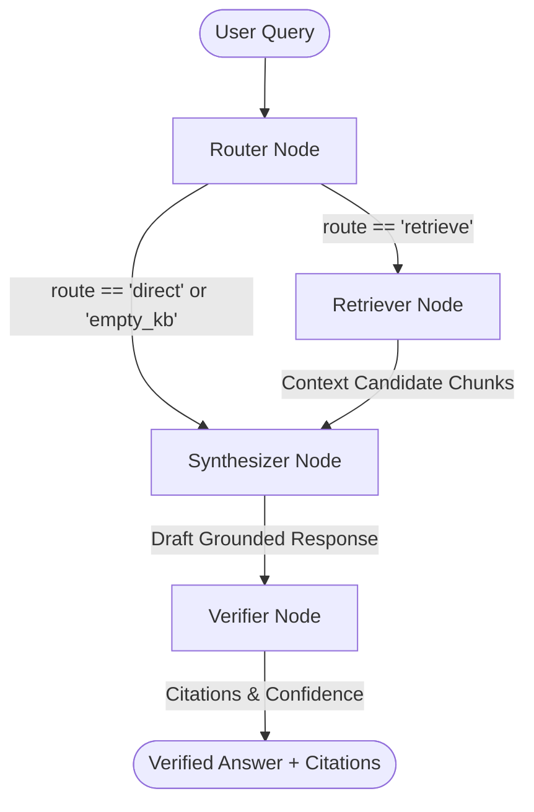

# 🧠 Synapse RAG • Personal AI Knowledge Assistant

An Agentic Retrieval-Augmented Generation (RAG) knowledge chatbot powered by **LangGraph 2.0**, **ChromaDB**, **FastAPI**, and modern **React (Vite)**. Features user authentication, verifiable grounded citations, vector chunk inspection, dynamic state machine visualization, and zero-setup offline extractive synthesis.

---

## 🌟 Key Features

1. **🧭 LangGraph 2.0 StateGraph Pipeline**:
   - **Router Node**: Classifies queries into conversational greetings vs. document retrieval.
   - **Retriever Node**: Executes dense vector search across ChromaDB using cosine similarity and lexical overlap score boosting.
   - **Synthesizer Node**: Synthesizes responses using configured LLM (Gemini, OpenAI, Groq, Ollama) or built-in offline grounded synthesis.
   - **Verifier Node**: Anchors every claim with verifiable citations, page numbers, match percentages, and confidence scores.

2. **🔐 User Authentication & Session Security**:
   - Sleek glassmorphic Login & Registration modal.
   - Salted SHA-256 password hashing and Bearer token session management.
   - Instant 1-click Quick Demo logins (`demo` / `demo123` and `admin` / `admin123`).
   - Chatbot is securely protected until the user signs in.

3. **📑 Verifiable Grounded Citations & Chunk Inspection**:
   - Clickable citation badges on assistant answers showing source file, page number, and similarity score.
   - Source passage drawer displaying exact context chunks.
   - Full document chunk inspector in the sidebar.

4. **✨ Zero-Setup Offline Mode + Multi-LLM Support**:
   - Works immediately out of the box without any API keys required using local grounded extractive synthesis.
   - Settings modal enables 1-click configuration for Google Gemini, OpenAI, Groq, or local Ollama with real-time connection testing.

5. **🚀 Browser-Ready Single Server**:
   - FastAPI serves both the REST API and the built React frontend at `http://localhost:8000`.
   - Single-click launch with `run.bat` or `start.ps1` that automatically opens your browser!

---

## 🏗️ LangGraph Architecture Diagram



---

## 🚀 Quick Start (Running on the Browser Easily)

### Method 1: One-Click Windows Launcher (Easiest)
Simply double-click:
```cmd
run.bat
```
*(This starts the FastAPI server and automatically opens `http://localhost:8000` in your default browser!)*

### Method 2: Manual Terminal Startup
```powershell
# In PowerShell:
.\venv\Scripts\python.exe -m uvicorn backend.app:app --host 127.0.0.1 --port 8000
```
Then navigate to: **`http://localhost:8000`**

### Method 3: Frontend Development (with HMR)
If you want to modify the React frontend with Vite Hot Module Replacement:
```powershell
cd frontend
npm run dev
```
Accessible at: **`http://localhost:5173`** (proxies `/api` to backend).

---

## 🔑 Default User Accounts

| Username | Password | Role | Description |
| :--- | :--- | :--- | :--- |
| `demo` | `demo123` | Researcher | Standard user with document upload & Q&A access |
| `admin` | `admin123` | Administrator | Administrative privileges & knowledge management |

*(You can also click **"Register now"** to create a custom account!)*

---

## 📡 REST API Reference

| Method | Endpoint | Description | Auth Required |
| :--- | :--- | :--- | :--- |
| `POST` | `/api/auth/login` | Authenticate user & return token | No |
| `POST` | `/api/auth/register` | Register new user account | No |
| `GET` | `/api/auth/me` | Fetch active user profile | Yes |
| `POST` | `/api/auth/logout` | Terminate session token | Yes |
| `GET` | `/api/health` | Server & vector database stats | No |
| `GET` | `/api/documents` | List all indexed documents | Yes |
| `POST` | `/api/documents/upload` | Upload & chunk PDF/TXT/MD file | Yes |
| `POST` | `/api/documents/load-sample` | 1-click load preloaded articles | Yes |
| `GET` | `/api/documents/{id}/chunks` | Inspect raw chunks for document | Yes |
| `DELETE` | `/api/documents/{id}` | Remove document and vector chunks | Yes |
| `POST` | `/api/chat` | Execute LangGraph RAG pipeline | Yes |
| `GET` | `/api/graph/info` | Return LangGraph nodes and edges | No |
| `POST` | `/api/test-llm` | Test API key connection for LLM | No |
